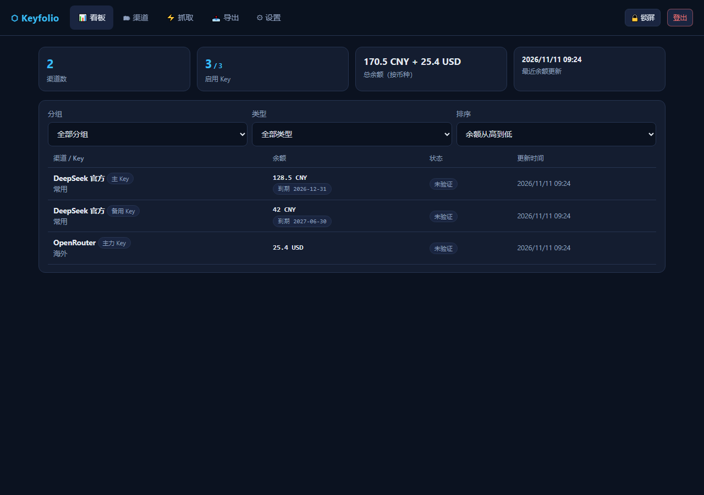
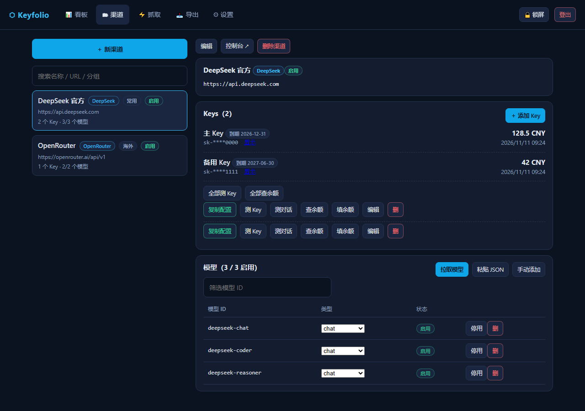
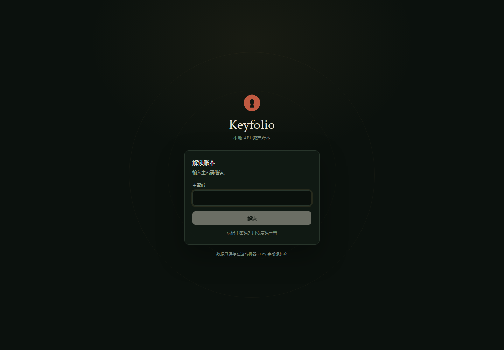
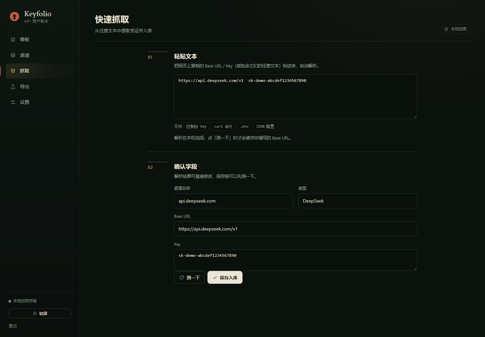

# Keyfolio · Local-first API Asset Ledger

[](LICENSE)
[](https://www.python.org/)
[](https://github.com/Civinar-Riley/keyfolio/releases)

[中文](README.md) | English

Bring API keys scattered across platforms into one local service: encrypted storage, one-click verification, model sync, balance checks, a ledger-style dashboard, and template-driven config export. Data stays on your machine; key fields are encrypted with AES-GCM.

<p align="center">
  
  
</p>

## Why

The more API keys you hold, the messier it gets. Balances live on a dozen sites, model lists and base URLs are buried in notes, and every new client means assembling the same fields again.

Keyfolio collects all of that into one local FastAPI + SQLite service. No accounts, no cloud sync, no telemetry; outbound requests only go to the channel URLs you configure.

## Features

### Credentials & channels

- A channel holds multiple keys, with create / edit / delete in one place; key values are masked by default and support expiry dates, groups, notes, and enable/disable
- Provider presets for OpenAI / Claude / Gemini / DeepSeek / SiliconFlow / OpenRouter / Moonshot / Zhipu fill in base URL and console link
- Saving the same base URL again appends a key instead of creating a duplicate channel

### Verification, models & balances

- Verify a key with `GET /v1/models` (free), or send a real `max_tokens=1` request; reasoning models automatically switch to `max_completion_tokens`
- Pull the remote model list, review added / removed / revived entries, then apply the sync; removed models are disabled rather than deleted, and manual disables are preserved
- Balance adapters for DeepSeek / SiliconFlow / OpenRouter and others, with generic read-only probing as a fallback, explicit failure reasons, and manual entry; every check is recorded to history
- Scheduled balance checks and model syncs, configurable per interval; automatic checks never overwrite manually entered expiry dates or currencies

### Dashboard & export

- One page for every key's balance, status, and expiry, with group / type filters and balance / updated-time sorting; click a row for a 7 / 30 / 90 / 365-day balance trend
- Placeholder templates (`{name}`, `{base_url}`, `{api_base}`, `{key}`, `{model}`, `{models}`, …) with built-ins for SillyTavern / ZCode / dsh / .env / cURL / OpenAI SDK / generic JSON; templates are editable
- `{api_base}` appends a version segment only when missing, so base URLs with or without `/v1` never double up

### Security & backup

- Master password with optional TOTP 2FA and backup codes; a recovery code resets the password; five failed attempts trigger a five-minute lockout
- Field-level AES-GCM encryption for key values and TOTP secrets; the data key is wrapped separately by the master password (scrypt) and the recovery code
- Server-side screen lock: data APIs return 423 while locked, surviving a refresh or a new tab; sessions expire after 7 days idle, and changing the password signs out other devices
- Full `.json` backups, optionally encrypted; imports support overwrite or merge-and-dedup, and encrypted backups restore login credentials and key ciphertext across installations

## Interface

The desktop layout pairs a ledger-style sidebar with a main workspace. On a phone, the same URL gives the full interface. Below 940px it switches to bottom navigation; at phone widths, channel lists become cards and forms and dialogs go single-column.

<p align="center">
  
  
</p>

## Quick Start

All three ways of running share the same code and data format. `data.db` and `app.log` live under `data/` next to the working directory by default; Docker uses `/app/data`.

### Windows exe (recommended)

Download [keyfolio.exe](https://github.com/Civinar-Riley/keyfolio/releases/latest/download/keyfolio.exe), double-click, and the browser opens automatically.

The exe is not code-signed, so SmartScreen may show an "unknown publisher" prompt on first launch. The data folder sits next to the exe, so moving the folder moves everything.

### Docker (NAS / server)

```bash
docker compose up -d
# open http://<host>:7465
```

Mounts `./data:/app/data`; env vars `KEYFOLIO_PORT` (default 7465) and `TZ`. The container listens on `0.0.0.0`; use a strong master password and only expose it on a trusted network.

### Native Python

```bash
pip install -r requirements.txt
python main.py
# default http://127.0.0.1:7465
```

Override with `KEYFOLIO_HOST` / `KEYFOLIO_PORT` / `KEYFOLIO_DATA_DIR`. On Linux, systemd works well:

```ini
[Service]
ExecStart=/usr/bin/python3 /path/to/keyfolio/main.py
WorkingDirectory=/path/to/keyfolio
Restart=on-failure
```

## First Run

1. Set a master password and save the one-time recovery code
2. Create a channel under Channels and add a key, or paste any text containing a base URL / key into Quick capture
3. Test the key, pull models, check balances, then generate a config from Export

> Without the master password and recovery code, the data cannot be decrypted. Keep the recovery code and an encrypted backup somewhere safe.

## Data & Security

- Sensitive fields are encrypted with a random data key using AES-GCM; the data key is wrapped separately by the master password (scrypt) and the recovery code
- The recovery code is shown once; resetting the password with it generates a new code
- Screen lock is server-side, but the data key remains in the server process memory and is cleared on restart
- Sessions are in-memory and require a new login after a restart; data is unaffected
- Backups containing plaintext keys show an explicit warning; encrypted backups are recommended
- No telemetry and no uploads; outbound requests only go to the channel URLs you configure

## Architecture

- Backend: Python + FastAPI + SQLite (WAL), httpx for outbound calls, asyncio scheduler
- Frontend: no-build Vue 3 (vendored ESM) + Chart.js, responsive layout, PWA (manifest + Service Worker)
- Packaging: Windows PyInstaller onefile / Docker / native Python

```
main.py                 entry point (uvicorn / auto-open browser in the exe)
app/
  main.py               FastAPI assembly and static serving
  db.py crypto.py auth.py scheduler.py services.py
  adapters/             per-provider model and balance adapters
  routers/              REST API
  static/               no-build frontend (Vue 3 ESM + Chart.js)
scripts/
  build_exe.bat         Windows packaging
  e2e_native.py         end-to-end test
  mock_platform.py      local fake platform
  gen_icons.py          PWA / exe icons (requires Pillow)
Dockerfile
docker-compose.yml
```

## Development

```bash
pip install -r requirements.txt
python main.py                 # dev server
python scripts/e2e_native.py  # end-to-end test (starts its own fake platform on port 39001)
```

The frontend has no build step: edit files under `app/static/` and refresh the browser. Vue and Chart.js are vendored; npm is not required.

Windows packaging:

```bat
scripts\build_exe.bat
```

## Limitations

- Generic balance probing is best-effort and depends on the target site's response format; platforms without a balance API still need manual entry
- Sessions are in-memory and expire after 7 days idle; a restart requires re-login (no data loss)
- The lock screen blocks API access, but the data key remains in server process memory until restart
- The onefile exe extracts on every launch (~2–3s) and is not code-signed
- PWA installation is unavailable over plain LAN HTTP (browser secure-context requirement); everything else still works

## License

[MIT](LICENSE)
