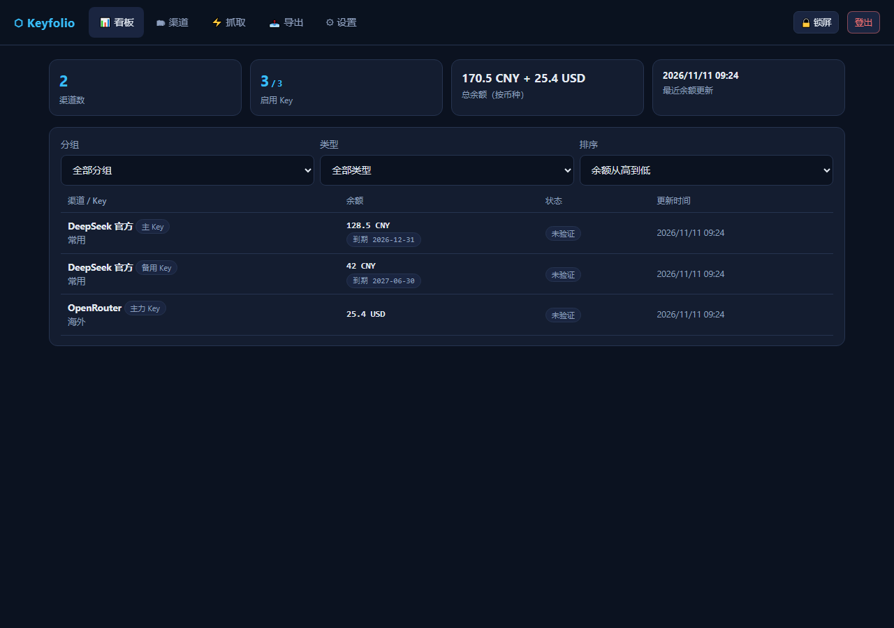
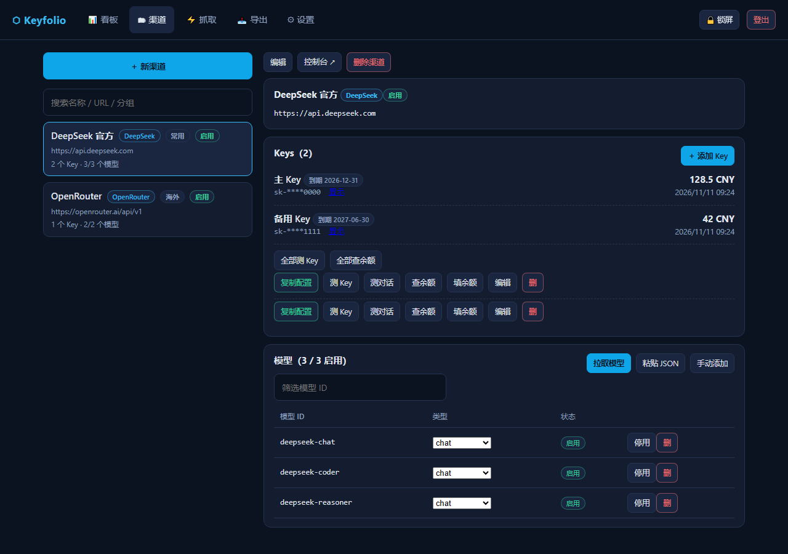
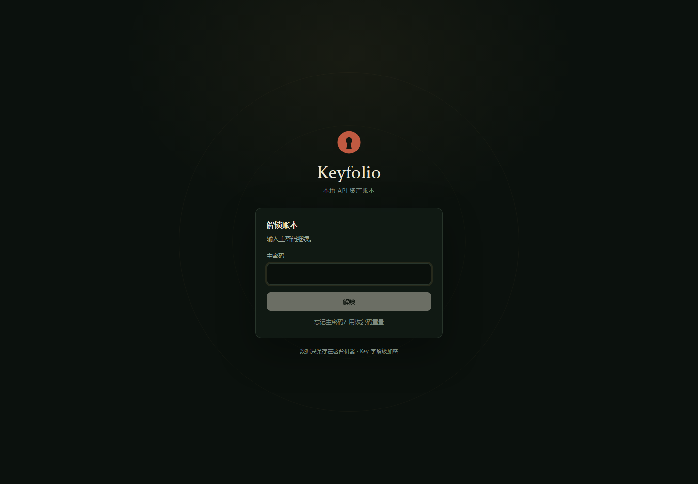
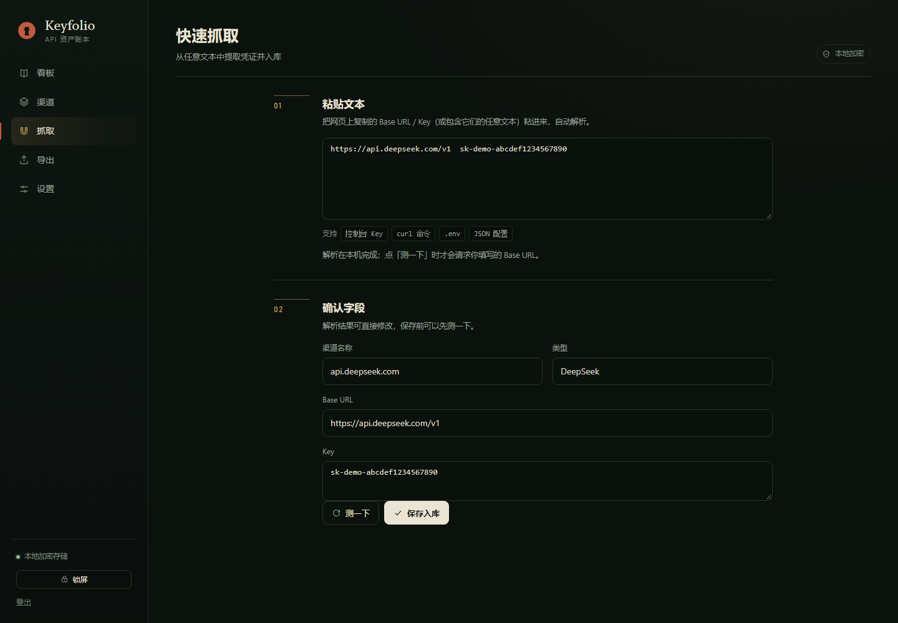

# Keyfolio · 本地 API 资产账本

[](LICENSE)
[](https://www.python.org/)
[](https://github.com/Civinar-Riley/keyfolio/releases)

[English](README.en.md) | 中文

把散落在各平台的 API Key 收进一个本机服务：加密保存、一键验证、同步模型、查询余额、看板看趋势，再按模板导出给任意客户端。数据留在你自己的机器上，Key 字段级 AES-GCM 加密。

<p align="center">
  
  
</p>

## 为什么做这个

API Key 一多，麻烦就跟着来：余额散落在各平台，想知道还剩多少要逐个登录；模型列表、Base URL 和 Key 分散在笔记和聊天记录里；给不同客户端配环境得反复拼字段。

Keyfolio 用一个本地 FastAPI 服务加 SQLite 把这些收进一个界面。没有账号体系、没有云同步、没有遥测；除了你主动触发的验证、查余额和定时任务，不会向外发请求。

## 功能

### 凭证与渠道

- 渠道挂多个 Key，统一增删改查；Key 值打码显示，支持到期日、分组、备注与启停
- 新建渠道可从 OpenAI / Claude / Gemini / DeepSeek / SiliconFlow / OpenRouter / Moonshot / 智谱等预设带出 Base URL 与控制台地址
- 同一 Base URL 再次抓取入库会追加 Key，不会重复建渠道

### 验证、模型与余额

- 测 Key 用 `GET /v1/models`（无消耗）；可选发一条 `max_tokens=1` 的真实请求验证推理，新推理模型自动改用 `max_completion_tokens`
- 拉取远端模型列表，对比新增 / 消失 / 重新出现后确认同步；消失的模型默认停用不删，手动停用的不会被自动启用
- 余额按渠道类型适配（DeepSeek / SiliconFlow / OpenRouter 等），失败走通用只读探测，再不行给出具体原因并支持手动填写；每次查询记入历史
- 定时任务可按间隔自动查余额、同步模型；自动查询不会覆盖手动填写的到期日与币种

### 看板与导出

- 看板汇总全部 Key 的余额、状态与到期情况，按分组 / 类型筛选、按余额 / 更新时间排序；点任意一行查看 7 / 30 / 90 / 365 天的余额趋势
- 占位符模板导出：`{name}`、`{base_url}`、`{api_base}`、`{key}`、`{model}`、`{models}` 等；内置 SillyTavern / ZCode / dsh / .env / cURL / OpenAI SDK / 通用 JSON，模板可增删改
- `{api_base}` 只在缺少版本段时补齐，Base URL 带不带 `/v1` 都不会拼重

### 安全与备份

- 主密码 + 可选 TOTP 2FA + 备用码；恢复码可在忘记主密码时重置密码；连续失败 5 次锁定 5 分钟
- Key 值与 TOTP 密钥字段级 AES-GCM 加密；data key 由主密码（scrypt）和恢复码分别包裹
- 服务端锁屏：锁屏期间数据接口返回 423，刷新或换标签页仍保持锁定；会话闲置 7 天失效，改密码踢出其他设备
- 全量备份导出为 `.json`，可整包加密；导入支持覆盖或合并去重，加密备份可跨实例恢复登录凭证与 Key 密文

## 界面

桌面端是左侧账簿导航加主工作区；手机浏览器打开同一地址就是完整界面。屏幕宽度小于 940px 时切底部导航；到手机宽度，渠道列表改卡片，表单与弹层改为单列。

<p align="center">
  
  
</p>

## 快速开始

三种跑法共用同一份代码与数据格式。数据库 `data.db` 和日志 `app.log` 默认落在运行目录的 `data/` 下；Docker 为 `/app/data`。

### Windows exe（推荐）

下载 [keyfolio.exe](https://github.com/Civinar-Riley/keyfolio/releases/latest/download/keyfolio.exe) 双击运行，自动打开浏览器。

exe 未做代码签名，首次运行可能被 SmartScreen 提示“未知发布者”；数据目录跟着 exe 所在文件夹走，整体复制即可迁移。

### Docker（NAS / 服务器）

```bash
docker compose up -d
# 打开 http://<主机IP>:7465
```

挂载 `./data:/app/data`；环境变量 `KEYFOLIO_PORT`（默认 7465）、`TZ`。容器内监听 `0.0.0.0`，请使用强主密码，并只在可信网络中暴露端口。

### 原生 Python

```bash
pip install -r requirements.txt
python main.py
# 默认 http://127.0.0.1:7465
```

可用 `KEYFOLIO_HOST` / `KEYFOLIO_PORT` / `KEYFOLIO_DATA_DIR` 覆盖。Linux 可交给 systemd：

```ini
[Service]
ExecStart=/usr/bin/python3 /path/to/keyfolio/main.py
WorkingDirectory=/path/to/keyfolio
Restart=on-failure
```

## 首次使用

1. 设置主密码，保存只显示一次的恢复码
2. 到「渠道」新建渠道并添加 Key，或在「快速抓取」粘贴任意包含 Base URL / Key 的文本
3. 「测 Key」「拉取模型」「查余额」；到「导出」选模板生成配置

> 主密码丢失且没有恢复码，数据无法解密。请把恢复码和加密备份放在安全的地方。

## 数据与安全

- 敏感字段用随机 data key 做 AES-GCM 加密；data key 由主密码（scrypt）和恢复码分别包裹存储
- 恢复码只在设置时显示一次；用它重置密码会生成新的恢复码
- 锁屏是服务端状态；但 data key 仍驻留在服务进程内存中，服务重启即清空
- 会话保存在内存，服务重启后需重新登录；数据不受影响
- 备份导出含 Key 明文时会明确提示，建议定期导出加密备份
- 没有遥测，也不会上传数据；所有出站请求只发往你配置的渠道地址

## 架构

- 后端：Python + FastAPI + SQLite（WAL），httpx 出站请求，asyncio 后台定时
- 前端：无构建 Vue 3（vendored ESM）+ Chart.js，响应式布局，PWA（manifest + Service Worker）
- 打包：Windows PyInstaller onefile / Docker / 原生 Python

```
main.py                 启动入口（uvicorn / exe 自动打开浏览器）
app/
  main.py               FastAPI 装配与静态托管
  db.py crypto.py auth.py scheduler.py services.py
  adapters/             各平台模型与余额适配
  routers/              REST API
  static/               无构建前端（Vue 3 ESM + Chart.js）
scripts/
  build_exe.bat         Windows 打包
  e2e_native.py         端到端测试
  mock_platform.py      本地假平台
  gen_icons.py          PWA / exe 图标（需要 Pillow）
Dockerfile
docker-compose.yml
```

## 开发

```bash
pip install -r requirements.txt
python main.py                 # 开发服务
python scripts/e2e_native.py  # 端到端测试（自行启动 39001 端口的假平台）
```

前端没有构建步骤：改 `app/static/` 里的文件，刷新浏览器即可。Vue 与 Chart.js 已 vendored，不需要 npm。

Windows 打包：

```bat
scripts\build_exe.bat
```

## 已知限制

- 通用余额探测是尽力而为，成功率取决于目标站响应格式；没有余额接口的平台仍需手动填
- 会话保存在内存，闲置 7 天失效；服务重启后需重新登录（数据无损）
- 锁屏会拦住 API 访问，但 data key 仍驻留在服务进程内存中（重启即清空）
- Windows onefile exe 每次启动解压，慢 2~3 秒；未做代码签名
- 局域网 HTTP 下 PWA 装机不可用（浏览器安全上下文限制），功能不受影响

## License

[MIT](LICENSE)
